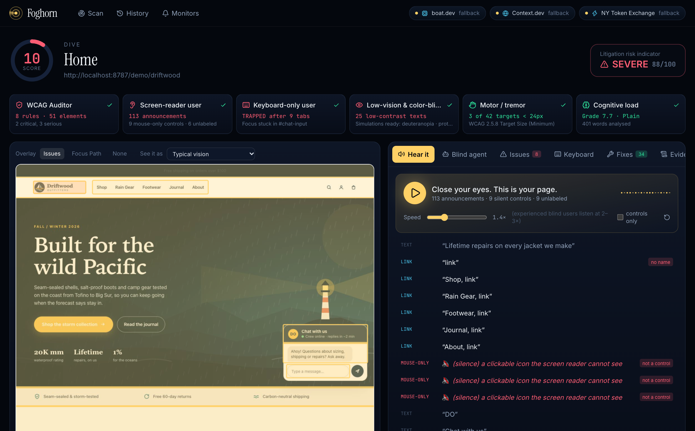
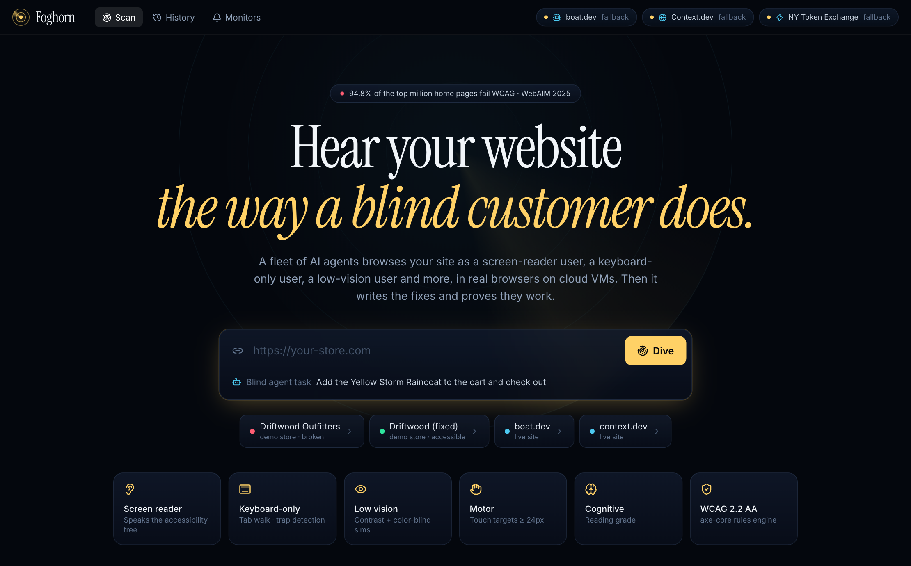
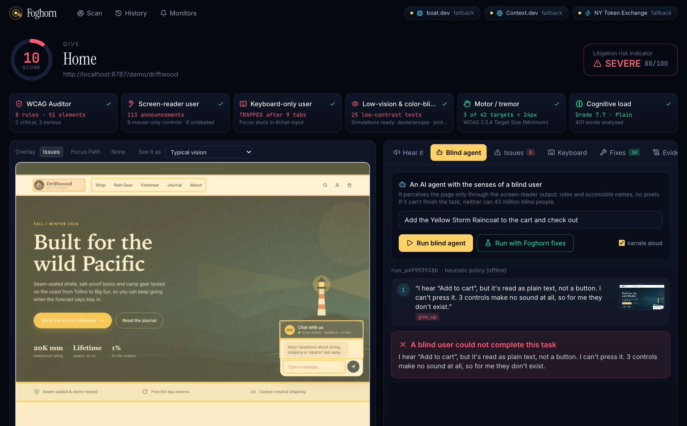
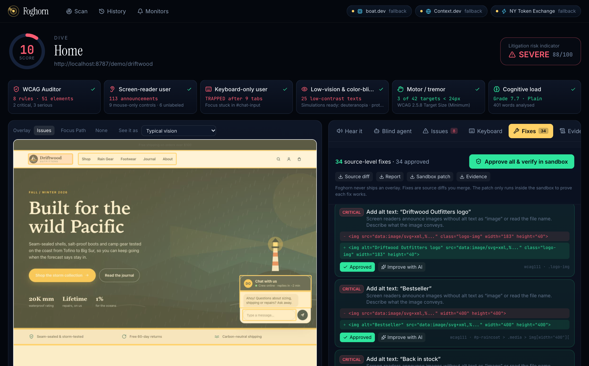
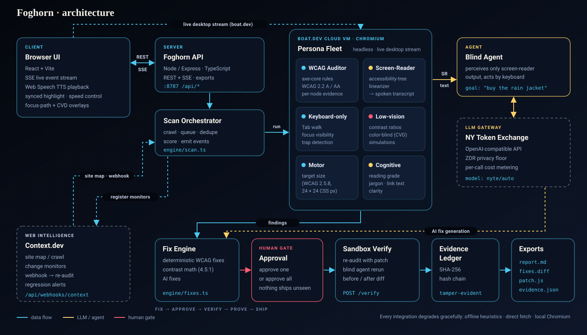
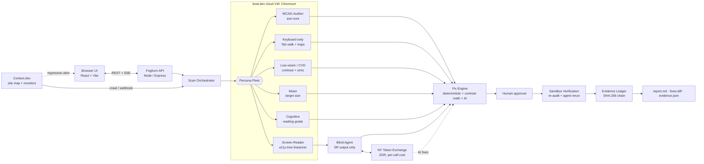
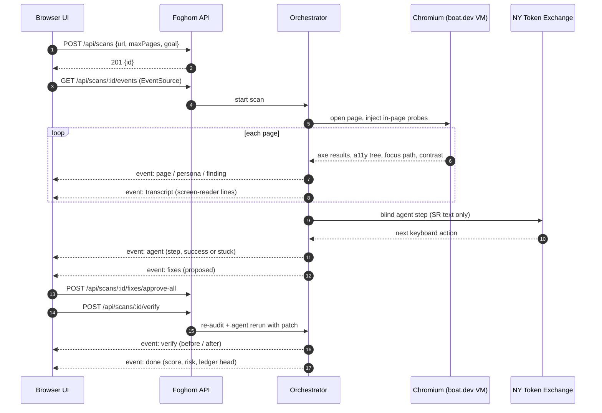

<div align="center">



<br/>

[](LICENSE)
[](https://www.typescriptlang.org/)
[](https://react.dev/)
[](https://github.com/dequelabs/axe-core)
[](https://www.w3.org/TR/WCAG22/)
<br/>
[](https://boat.dev)
[](https://context.dev)
[](#configuration)
[](CONTRIBUTING.md)
[](https://github.com/vnmoorthy/foghorn/actions/workflows/ci.yml)

<h3>
  <a href="https://vnmoorthy.github.io/foghorn/">▶ Try the live demo</a> &nbsp;·&nbsp;
  <a href="https://vnmoorthy.github.io/foghorn/deck/">🎞 Pitch deck</a> &nbsp;·&nbsp;
  <a href="https://vnmoorthy.github.io/foghorn/demo/driftwood.html">🛒 The broken demo store</a>
</h3>
<sub>The live demo is an interactive replay of real recorded runs. Every tab, overlay, simulation, playback and export works in your browser. Run it locally to dive into any site.</sub>

<a href="https://vnmoorthy.github.io/foghorn/"></a>

**Foghorn runs a fleet of disability personas against your site, plays you what a screen reader actually says, sends a blind AI agent to try your checkout, then ships sandbox-verified fixes with a tamper-evident audit trail.**

[Quickstart](#quickstart) · [How it works](#how-it-works) · [Architecture](docs/ARCHITECTURE.md) · [API](#api-reference) · [Deploy on boat.dev](#deploy-on-boatdev) · [50-judge validation](research/README.md) · [Roadmap](#roadmap)

<sub>Built at the <a href="https://boathackathon.com">Boat Hackathon</a>, aboard the Historic Klamath, Pier 9, San Francisco.</sub>

</div>

---

## Close your eyes

Close your eyes and open your own website. You'll hear something like *"button. button. image. link, click here."* That's your store as a blind customer hears it: no product name, no price, no idea which button adds the jacket to the cart. Lighthouse scores and red squiggles never made anyone feel that. **Foghorn plays it out loud**, shows you where keyboard focus gets stuck, lets you watch a blind agent fail to buy something, and then fixes the page and proves the fix worked.

## Why

| | |
|---|---|
| **1.3 billion** | people live with significant disability, about 1 in 6 people worldwide ([WHO, 2023](https://www.who.int/news-room/fact-sheets/detail/disability-and-health)) |
| **94.8%** | of the top 1,000,000 home pages have detectable WCAG failures ([WebAIM Million, 2025](https://webaim.org/projects/million/)) |
| **June 28, 2025** | the **European Accessibility Act** became enforceable for e-commerce, banking, transport and more across the EU |
| **4,000+** | US digital accessibility lawsuits are filed every year |
| **$1M** | the FTC fined overlay vendor **accessiBe** in January 2025 over claims its widget made sites compliant |

Teams don't ignore accessibility because they don't care. They ignore it because audits are slow, abstract and expensive, and the "one line of JavaScript" overlays don't work. Foghorn makes the problem *audible* and the fix *verifiable*.

## Features

- **Persona fleet.** Six automated personas audit every page in parallel: **WCAG Auditor** (axe-core), **Screen-Reader** (accessibility-tree linearizer), **Keyboard-only** (Tab walk with trap detection), **Low-vision and color-blind** (contrast plus CVD simulations), **Motor** (target size) and **Cognitive** (reading grade).
- **Hear it.** Screen-reader playback through Web Speech TTS, with a synced on-page highlight of the node being spoken and adjustable speed.
- **Blind agent.** An LLM agent that perceives *only* the screen-reader output and acts only by keyboard, given a real goal like "buy the rain jacket". If it can't finish, neither can your customers.
- **Keyboard focus-path visualizer.** Numbered focus order drawn over the page, with focus traps and invisible focus flagged.
- **Vision simulations.** Protanopia, deuteranopia, tritanopia, achromatopsia and low-vision blur, side by side.
- **Contrast-math auto-fix.** Computes the nearest on-brand color that meets WCAG 4.5:1 or 3:1. No guessing, no LLM needed.
- **One-click source fixes, human-approved.** Deterministic fixes for common WCAG failures plus AI-generated fixes for the long tail. Nothing applies until a person approves it, individually or all at once.
- **Sandbox verification.** Every approved patch is re-audited and the blind agent re-runs against the patched page, with before/after scores and transcripts.
- **SHA-256 evidence ledger.** Each scan, finding, approval and verification is appended to a hash chain, so your audit trail is tamper-evident and independently verifiable.
- **Context.dev change monitors.** Foghorn watches your pages and re-audits when they change, raising **regression alerts** when a deploy breaks accessibility.
- **Risk indicator.** A plain-language legal-exposure signal based on findings. *Not legal advice.*
- **Exports.** `report.md`, `fixes.diff`, `patch.js` and `evidence.json`.

## Screenshots

<p align="center">
  
</p>

<table>
<tr>
<td width="33%"><br/><sub><b>Dive</b>: any URL + a task for the blind agent</sub></td>
<td width="33%"><br/><sub><b>Blind agent</b>: “I hear ‘Add to cart’, but it’s plain text, not a button.”</sub></td>
<td width="33%"><br/><sub><b>Fixes</b>: source diffs, contrast math, human approval, sandbox verify</sub></td>
</tr>
</table>

<p align="center"><b>Real results on the Driftwood demo store:</b> score <code>10/100 → 73/100</code> · keyboard trap released · 42/42 controls reachable · blind agent goes from <i>“I can't press it”</i> to <i>“Order placed!”</i>
</p>

## How it works

<p align="center">
  
</p>



### A scan, event by event

The UI never polls. Every stage of a scan streams to the browser over Server-Sent Events.



## Quickstart

**Requirements:** Node 20+ and Google Chrome installed locally.

```bash
cd web
npm install
npm run dev
```

Open **http://localhost:5173** and click the **Driftwood Outfitters** demo. It's a deliberately inaccessible outdoor-gear store; Foghorn will scan it, read it aloud, send the blind agent to buy a rain jacket, and propose fixes you can approve and verify.

No API keys are needed to try it. Every integration degrades gracefully.

## Configuration

Create `web/.env`:

| Variable | Default | Purpose |
|---|---|---|
| `NYTE_API_KEY` | none | NY Token Exchange key (`sk-tr-…`). Powers the blind agent and AI fixes. |
| `NYTE_MODEL` | `nyte/auto` | Model routed through NY Token Exchange. |
| `NYTE_PRIVACY` | `zdr` | Privacy floor. `zdr` routes only to zero-data-retention providers. |
| `CONTEXT_DEV_API_KEY` | none | Context.dev key for site maps, crawling and change monitors. |
| `BOAT_API_KEY` | none | boat.dev key for running Chromium on cloud VMs with a live desktop stream. |
| `PUBLIC_URL` | none | Public base URL of this server, so Context.dev can deliver webhooks. |
| `CHROME_PATH` | auto-detected | Path to a local Chrome or Chromium binary. |
| `PORT` | `8787` | API server port. |

**Graceful degradation:** without `NYTE_API_KEY` the agent and fixes fall back to offline heuristics; without `CONTEXT_DEV_API_KEY` pages are fetched directly; without `BOAT_API_KEY` scans run in your local Chromium.

## Deploy on boat.dev

One command creates a boat.dev VM, clones Foghorn, builds it, starts it with the VM's own Chrome, and serves it on a public HTTPS URL:

```bash
curl -fsSL https://boat.dev/install | sh        # install the boat CLI, then: boat onboard
boat new --name foghorn-live --host 8787:public \
  --file setup.sh=deploy/boat-setup.sh --setup-file deploy/boat-setup.sh
```

`boat info <id>` shows `setupStatus`. The script prints `FOGHORN_READY` when the server answers, and logs go to `/home/user/foghorn.log` on the VM. Set `PUBLIC_URL` to the hosted URL so Context.dev webhooks reach your instance.

<details><summary>Step by step instead</summary>

```bash
boat new --type default                                   # prints bx_…
boat exec <id> "git clone https://github.com/vnmoorthy/foghorn"
boat exec <id> --cwd foghorn/web --detach "npm ci && npx vite build && PORT=8787 FOGHORN_ON_BOAT=1 npm start"
boat host <id> 8787 --public
```
</details>

**Live desktops:** with `BOAT_API_KEY` set, Foghorn starts one boat.dev VM, reuses it for every scan, opens the audited site on its desktop, and embeds the live 60 fps stream next to the results. Reusing one VM keeps it within the trial's 2-sandbox limit.

## Project status

| | Status |
|---|---|
| Scan engine, 6 personas, blind agent, fixes, sandbox verification, evidence ledger, monitors | ✅ Working, with an automated UI click-through (34/34 checks) |
| Live replay (GitHub Pages) | ✅ [vnmoorthy.github.io/foghorn](https://vnmoorthy.github.io/foghorn/) |
| Pitch deck + 3-minute storyboard | ✅ [deck](https://vnmoorthy.github.io/foghorn/deck/) · [STORYBOARD.md](deck/STORYBOARD.md) · [PPTX](deck/Foghorn-Pitch.pptx) |
| NY Token Exchange (blind-agent brain, AI fixes) | 🔑 Add `NYTE_API_KEY`. Without it, Foghorn uses a deterministic agent policy and deterministic fixes. |
| Context.dev (site mapping, change monitors) | 🔑 Add `CONTEXT_DEV_API_KEY`. Without it, Foghorn crawls links itself and runs a local 15-second watcher. |
| boat.dev (live VM desktops, hosting) | 🔑 Add `BOAT_API_KEY` and an active plan. Without them, Foghorn uses local Chrome. |

## API reference

| Method | Path | Description |
|---|---|---|
| `GET` | `/api/status` | Integration status (NYTE, Context.dev, boat.dev, Chrome). |
| `POST` | `/api/scans` | Start a scan. Body: `{ url, maxPages, goal }`. |
| `GET` | `/api/scans` | List scans. |
| `GET` | `/api/scans/:id` | Full scan result. |
| `GET` | `/api/scans/:id/events` | Live scan events (SSE). |
| `POST` | `/api/scans/:id/agent` | Run the blind agent. Body: `{ goal, patched }`. |
| `POST` | `/api/scans/:id/fixes/:fixId/approve` | Approve one fix. |
| `POST` | `/api/scans/:id/fixes/approve-all` | Approve all proposed fixes. |
| `POST` | `/api/scans/:id/fixes/:fixId/ai` | Generate an AI fix for a finding. |
| `POST` | `/api/scans/:id/verify` | Sandbox verification: re-audit plus agent rerun with the patch. |
| `GET` | `/api/scans/:id/report.md` | Markdown report. |
| `GET` | `/api/scans/:id/fixes.diff` | Approved fixes as a unified diff. |
| `GET` | `/api/scans/:id/patch.js` | Approved fixes as a runtime patch. |
| `GET` | `/api/scans/:id/evidence.json` | Evidence ledger export. |
| `GET` | `/api/scans/:id/evidence/verify` | Verify the SHA-256 hash chain. |
| `POST` | `/api/monitors` | Create a Context.dev change monitor. Body: `{ scanId }`. |
| `GET` | `/api/monitors` | List monitors. |
| `POST` | `/api/monitors/:id/check` | Force a monitor check. |
| `POST` | `/api/webhooks/context` | Context.dev change webhook (triggers re-audit). |
| `POST` | `/api/demo/regress` | Toggle a simulated regression on the demo site. Body: `{ on }`. |

## Project structure

```
foghorn/
├── assets/                    # banner, architecture diagram, screenshots
├── web/
│   ├── server/
│   │   ├── index.ts           # Express API, SSE, exports, webhooks
│   │   ├── engine/
│   │   │   ├── scan.ts        # orchestrator + persona fleet
│   │   │   ├── agent.ts       # blind agent (screen-reader-only perception)
│   │   │   ├── fixes.ts       # deterministic, contrast-math and AI fixes
│   │   │   ├── store.ts       # scans + SHA-256 evidence ledger
│   │   │   └── inpage.js      # in-page probes: a11y tree, focus walk, contrast
│   │   ├── lib/
│   │   │   ├── llm.ts         # NY Token Exchange client
│   │   │   ├── context.ts     # Context.dev client
│   │   │   └── boat.ts        # boat.dev VM client
│   │   └── demo/
│   │       ├── driftwood.html        # inaccessible demo store
│   │       └── driftwood-fixed.html  # same store, fixed
│   └── src/                   # React + Vite UI
├── deck/                      # pitch deck
└── research/                  # judge-panel simulation, raw results
```

## Why not an overlay?

Overlays inject a widget on top of a broken page and promise compliance. They don't fix the source, they often fight real assistive technology, and in January 2025 the FTC fined the best-known vendor $1M for claiming otherwise. Foghorn takes the opposite approach:

| | Overlay widgets | Foghorn |
|---|---|---|
| Where the fix lives | Runtime JavaScript on top of the page | Your source code (`fixes.diff`) |
| Who approves changes | Nobody | A human, per fix |
| Proof it worked | Vendor claim | Re-audit plus blind-agent rerun, before/after |
| Audit trail | None | SHA-256 hash-chained evidence |
| Works with real screen readers | Often conflicts | Fixes the semantics they read |

## Validation: a 50-judge panel

Before writing code we simulated a panel of **50 judges** (sponsor founders, VCs, a blind accessibility advocate, engineers) scoring **26 candidate ideas**. Foghorn scored **8.6/10** overall, ranked **#1 for 33 of 50** judges and **top-3 for 46 of 50**. Raw results are in [`research/`](research/).

## Roadmap

- [ ] **CI gate:** a GitHub Action that fails a PR when accessibility regresses
- [ ] **PR bot:** open pull requests with approved fixes against your repo
- [ ] **Real screen readers:** NVDA and VoiceOver running inside boat.dev VMs
- [ ] **Mobile apps:** iOS and Android accessibility trees
- [ ] **PDF accessibility:** tagged-PDF auditing and remediation
- [ ] **Multilingual:** transcripts, TTS and reading-grade analysis beyond English

## Contributing

PRs are welcome. See [CONTRIBUTING.md](CONTRIBUTING.md). Good first issues: new persona checks, more deterministic fix recipes, and better CVD simulation matrices.

## Limitations

Automated testing catches only a subset of WCAG issues. Foghorn finds a lot, and makes what it finds hard to ignore, but it doesn't replace testing with disabled users and manual expert review. The risk indicator is a heuristic. **Foghorn is not legal advice.**

## License

[MIT](LICENSE) © 2026 Foghorn contributors

## Acknowledgements

- [Boat Hackathon](https://boathackathon.com), for the deck of the Historic Klamath
- [boat.dev](https://boat.dev), cloud VMs with live desktop streams
- [Context.dev](https://context.dev), site maps and change monitoring
- NY Token Exchange, an OpenAI-compatible LLM gateway with a ZDR privacy floor
- Teamily
- [axe-core](https://github.com/dequelabs/axe-core) by Deque Systems
- [WebAIM](https://webaim.org), for the WebAIM Million and years of accessibility education
